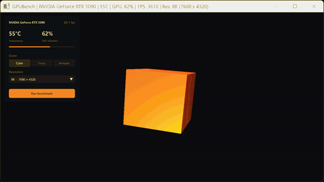

# GPUBench

A small GPU benchmark I made with C++ and OpenGL.



It has 3 scenes:
- **Cube**: a single spinning lit cube (light load)
- **Torus**: a fur covered donut drawn as 64 layers (heavy on pixel shading)
- **Armada**: 5000 instanced cubes orbiting around (heavy on geometry)

You can render at 720p, 1080p, 1440p, 4K or 8K no matter what size the window is. The scene gets drawn into an offscreen framebuffer at that resolution and then scaled to the window.

The benchmark runs for 30 seconds and gives a score based on average fps, the resolution and the scene. GPU temperature and usage come from NVML, so those only show up on NVIDIA cards.

## Building

Windows with MSYS2 (ucrt64) g++:

```
g++ -O2 main.cpp glad.c imgui/imgui.cpp imgui/imgui_draw.cpp imgui/imgui_tables.cpp imgui/imgui_widgets.cpp imgui/imgui_impl_glfw.cpp imgui/imgui_impl_opengl3.cpp -Iinclude -Iimgui -Llib -o main.exe -lglfw3 -lopengl32 -lgdi32 -limm32
```

Or just run the build task in VS Code.

## Files

- `main.cpp`: window setup and main loop
- `scenes.h`: the 3 scenes and lights
- `shaders.h`: GLSL shaders
- `cube.h`, `torus.h`: meshes
- `render_target.h`: offscreen framebuffer
- `benchmark.h`: resolutions and scoring
- `gpu_monitor.h`: temperature and usage through NVML
- `hud.h`: the UI (Dear ImGui)

## Libraries

GLFW, GLAD, GLM, Dear ImGui (MIT license, see `imgui/LICENSE.txt`)
